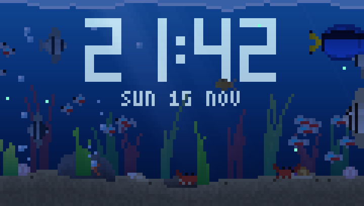
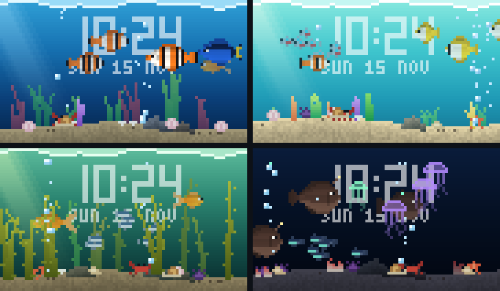

# ascii-fish-tank

[](https://github.com/WasathTheekshana/ascii-fish-tank/actions/workflows/ci.yml)

A fish tank that fills the terminal. Clownfish, blue tangs, angelfish, goldfish and schools of neon tetras swim between swaying plants, and now and then a shark passes through. Crabs and snails walk over a sandy bottom scattered with shells, starfish and urchins. Light falls in rays from the surface, bubbles rise from the sand, and you can drop food for the fish to chase.

A clock and the date sit in the water. Both can be hidden and the clock can be resized. At night the tank goes dark and plankton glows. An optional panel shows CPU, memory, disk, temperature and load. The reef is one of four scenes, next to a lagoon, a kelp forest and the deep sea.




The pictures above are the pixel style at 120 by 34 characters. Each character cell holds two pixels, one above the other, so the tank has twice the vertical detail of normal terminal text. The fish are not stored pictures. They are drawn from a shape and colour description at whatever size the tank needs.

The four scenes, picked with the keys `1` to `4`:



There is also a plain ASCII style, for terminals without colour or Unicode:

```
^^^~~~-----~~~~~~~~~--------~~~~~~~~~----~~~^^^^^^~~~-----~~~~~~~~~--------~~~

            ######  ######      ######  ######
                ##  ##  ##  ##      ##  ##  ##                   ><{{{*>
            ######  ##  ##      ######  ######    ,--.
            ##      ##  ##  ##      ##      ##  <o    >=<
            ######  ######      ######  ######    `--'

       /\                   Sun 15 Nov 2026            O
     _/  \                                                           <><
    <o    )><                                          o
      \_  /        (                                              _   _   _
        \/         (        )                (         .         | |_| |_| |
   (                )       )        (       (                   |         |
   (                )      (          )       )                  |   ,-.   |
    )              (       (          )       )                  |   | |   |
    )   o@   V(o,o)V       (         (       (                   |___|_|___|
:..,._;_:.,;._:,,.:,.._,.,..,.;,.,;_:_;._;..:___,:.;:;.__,::,:;_.;.;_,.:,:,_,.
```

Press `v` to switch between the two while it runs. It runs on Linux, macOS and WSL.

## Install

### Nix

Run it without installing:

```
nix run github:WasathTheekshana/ascii-fish-tank
```

Install it into your profile:

```
nix profile install github:WasathTheekshana/ascii-fish-tank
```

If flakes are not enabled, add `--extra-experimental-features "nix-command flakes"` to either command.

On NixOS with a flake config, add the repo as an input and put the package in `environment.systemPackages`:

```nix
inputs.ascii-fish-tank.url = "github:WasathTheekshana/ascii-fish-tank";

environment.systemPackages = [
  inputs.ascii-fish-tank.packages.${pkgs.system}.default
];
```

### Ubuntu and Debian

Download the `.deb` from the latest release and install it with apt:

```
curl -LO https://github.com/WasathTheekshana/ascii-fish-tank/releases/latest/download/ascii-fish-tank.deb
sudo apt install ./ascii-fish-tank.deb
```

Remove it with `sudo apt remove ascii-fish-tank`.

### pipx or pip

This works on any system with Python 3.10 or newer:

```
pipx install git+https://github.com/WasathTheekshana/ascii-fish-tank
```

### From source

```
git clone https://github.com/WasathTheekshana/ascii-fish-tank
cd ascii-fish-tank
sudo make install
```

`make install` copies one file to `/usr/local/bin`. Set `PREFIX` to install somewhere else. You can also skip the install and run `python3 ascii_fish_tank.py`.

## Keys

| Key | Action |
|---|---|
| `q` or `Esc` | quit |
| `c` | show or hide the clock |
| `d` | show or hide the date |
| `[` / `]` | make the clock smaller or larger (pixel style) |
| `s` | show or hide seconds |
| `t` | switch between 12 and 24 hour time |
| `n` | switch night lighting on or off (pixel style) |
| `m` | show or hide the system monitor |
| `f` | drop food (pixel style) |
| `1` to `4` | pick a scene: reef, lagoon, kelp forest, deep sea (pixel style) |
| `v` | switch between the pixel and ASCII styles |
| `p` or space | pause |
| `+` / `-` | add or remove a fish |
| `?` | show the key list |

## Options

```
--style pixel|ascii        how the tank is drawn (default pixel)
--scene NAME               reef, lagoon, kelp or deep, in the pixel style (default reef)
--colors auto|true|256|16  colour depth for the pixel style (default auto)
--no-clock                 start with the clock hidden
--no-date                  start with the date hidden
--clock-size N             clock size in the pixel style, 1 to 8 (default fits the terminal)
--seconds                  show seconds on the clock
--12h                      12 hour clock
--night auto|on|off        night lighting in the pixel style (default auto)
--monitor                  show CPU, memory, disk, temperature and load
--fish N                   number of fish, 0 to 60 (default depends on the terminal size)
--fps N                    frames per second, 1 to 30 (default 10)
--no-color                 no colour, which also selects the ASCII style
--snapshot                 print one frame and exit
```

A smaller font gives a more detailed tank, because the tank has one pixel per half character. Zoom the terminal out (usually Ctrl and minus) to see more.

Below 30 by 10 characters the tank shows "terminal too small". Lower `--fps` if the machine runs warm.

## Scenes

| Key | Scene | What lives there |
|---|---|---|
| `1` | reef | clownfish, blue tangs, angelfish, goldfish, neon tetras, coral, sometimes a shark |
| `2` | lagoon | shallow turquoise water over pale sand, more coral, butterflyfish and a sea turtle |
| `3` | kelp forest | green water, kelp that reaches the surface, sardine schools, sometimes a shark |
| `4` | deep sea | no sunlight, glowing jellyfish, anglerfish with a lit lure, lanternfish, tube worms |

Switching scenes builds a new tank, so the fish start in new places. Start in a scene with `--scene`, for example `--scene deep`. The clock, night lighting, feeding and the monitor work in all four.

## Night

With `--night auto`, the default, the tank is dark from 19:00 to 06:00 by the system clock. Everything dims and turns bluer, the clock and date keep glowing, and plankton sparkles in the water. Press `n` to switch by hand, or start with `--night on` or `--night off`.

## System monitor

Press `m`, or start with `--monitor`, for a small panel above the sand with CPU, memory, disk, temperature and load. The bars turn yellow at 60% and red at 85%. Temperature is the hottest sensor the kernel reports, on a scale from 30 to 95 degrees.

All five readings need Linux. On other systems the panel shows the ones it can get, which is usually disk and load.

## Colours

The pixel style sends 24-bit colour by default. Most current terminals support it, including Windows Terminal, GNOME Terminal, Konsole, kitty, Alacritty and iTerm2. If the colours come out wrong, try `--colors 256`.

On the Linux console (the screen of the machine itself, `TERM=linux`) only 16 colours exist. There the program loads its own 16 colour palette for each scene while it runs and puts the default palette back on exit. The picture is coarser than in a 24-bit terminal. If the console font has no block characters, use `--style ascii`.

## What the program touches

The program is one Python file that imports only the standard library. It opens no network connections, writes no files, and starts no other programs. The only input it reads is key presses, one byte at a time, and unknown keys are ignored. Numeric options are range checked.

It reads no files unless the system monitor is on. With the monitor on it reads `/proc/stat`, `/proc/meminfo` and the temperature files under `/sys/class/thermal`, at most 4096 bytes each, every two seconds.

The Nix and `.deb` packages run Python with `-I`, so `PYTHONPATH` and the user site directory cannot replace the modules it imports. On exit, including Ctrl+C and SIGTERM, it restores the terminal settings and the cursor.

See [SECURITY.md](SECURITY.md) for how to report a problem.

## Contributing

See [CONTRIBUTING.md](CONTRIBUTING.md). The licence is [MIT](LICENSE).
